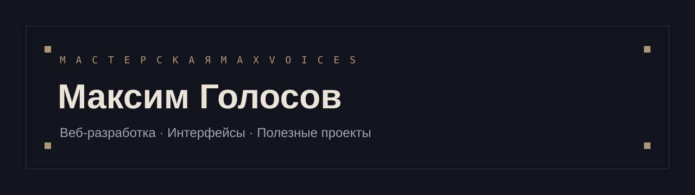

  

  <a href="https://t.me/MaxVoicesDeveloper">Написать мне</a> ·
  <a href="#избранные-работы">Посмотреть работы</a> ·
  <a href="https://github.com/MaxVoicesDeveloper?tab=repositories">Все репозитории</a>

# Привет, я Макс

Создаю сайты для бизнеса, разрабатываю интерфейсы и разбираюсь в том, как связать их с работающим продуктом. Люблю спокойную эстетику, пиксельные миры и вещи, которые решают конкретную задачу.

Здесь мои клиентские заказы, собственные проекты и эксперименты. За каждой работой стоят задача, мои решения и результат, который можно посмотреть в коде.

  
   Ночная мастерская. Кофе остывает, работа движется.

## Что я делаю

- **Сайты для бизнеса.** Превращаю задачу заказчика в структуру страницы, интерфейс и вёрстку.
- **Фронтенд.** Работаю с HTML, CSS, LESS, JavaScript и React. Уделяю внимание формам, состояниям и адаптивности.
- **Интеграции.** Работаю с Битрикс и PHP, развиваю навыки серверной разработки.
- **Собственные инструменты.** Экспериментирую с утилитами для macOS, автоматизацией и игровыми проектами.

## Избранные работы

<table>
<tr>
<td width="50%" valign="top">

### СтройДвор на Карболите

**Оплаченный клиентский заказ.** Редизайн главной страницы строительного рынка в Орехово-Зуево. Каталог, категории и адаптивная вёрстка.

HTML · CSS / LESS · JavaScript · jQuery

[Исходники](https://github.com/MaxVoicesDeveloper/stroydvor-karbolit) · [Открыть сайт](https://stroydvor.vercel.app)

</td>
<td width="50%" valign="top">

### DAR'YA · Ателье-мастерская

**Клиентский проект по бартеру.** Сайт ателье: услуги, примеры работ и связь с мастерской. Дизайн создавался прямо при вёрстке.

HTML · CSS · JavaScript

[Исходники и запуск](https://github.com/MaxVoicesDeveloper/darya-atelier)

</td>
</tr>
<tr>
<td width="50%" valign="top">

### Комментарии для kvan.tech

**Мой дизайн и код, написанный вручную без ИИ.** React-интерфейс с комментариями, вложенными ответами и валидацией форм.

React · Vite · JavaScript · CSS / LESS

[Исходники и запуск](https://github.com/MaxVoicesDeveloper/kvan-comments)

</td>
<td width="50%" valign="top">

### AVOS

**Собственный игровой проект.** Атмосферная сборка Minecraft 1.20.1 для игры с друзьями. Настройки, совместимость модов и оформление собраны в единый опыт.

Minecraft · Моды · Конфигурации · Веб

[Посмотреть проект](https://github.com/MaxVoicesDeveloper/avos)

### Synclick

Собственный проект веб-агентства: площадка для развития навыков и работы с клиентскими задачами.

[Посмотреть исходники](https://github.com/MaxVoicesDeveloper/Synclick)

</td>
</tr>
</table>

## Мои инструменты

| Задача | С чем работаю |
| :--- | :--- |
| Интерфейсы | HTML, CSS, LESS, JavaScript, React |
| Дизайн и вёрстка | Figma, адаптивные страницы, компоненты и формы |
| CMS и серверная часть | Битрикс, PHP |
| Рабочий процесс | Git, GitHub, VS Code, npm, Vite |
| Развиваю дальше | TypeScript, Next.js, MySQL, Laravel, Linux и Docker |

## Как я использую ИИ

ИИ помогает мне проверять идеи, быстрее собирать прототипы и разбираться в незнакомых инструментах. Задачу, направление работы и решения определяю я. В проектах честно указываю, где использовал ИИ, а где писал код самостоятельно.

Мой ориентир: понимать результат, уметь его проверить и довести до состояния, в котором им можно пользоваться.

## Дальше по пути

Углубляюсь в React и TypeScript, развиваюсь в сторону полноценной веб-разработки. Хочу делать полезные продукты и расти через реальные задачи, обратную связь и работу в команде.

## Давай поработаем

Открыт к обсуждению веб-проектов, клиентских задач и сотрудничества с командой.

**[Написать в Telegram](https://t.me/MaxVoicesDeveloper)** · [ВКонтакте](https://vk.com/maxvoices)

---

Максим Голосов · MaxVoices Спокойный ритм. Внимание к деталям. Код с характером.

